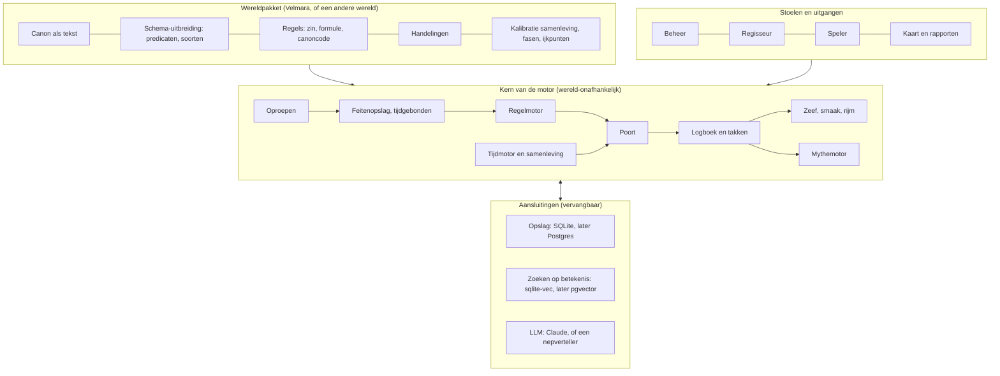
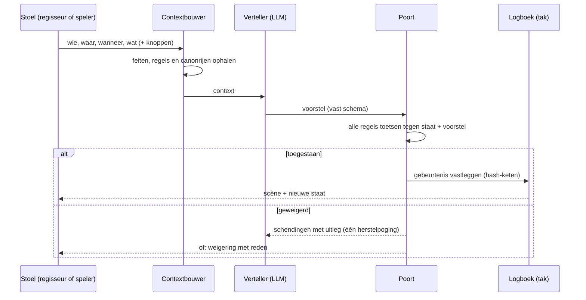
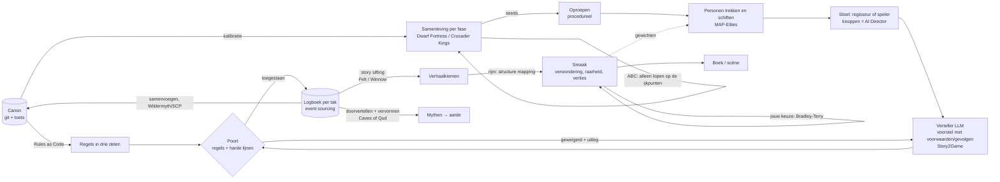

# Wereldmotor: architectuurschets

Versie 0.1 (schets), 1 november 2026. Opdrachtgever en canonhouder: Rogier. Opgesteld door de architect.
Status: **ter bespreking.** Er wordt nog niets gebouwd voordat deze schets is goedgekeurd en met eenvoudige proeven getest.

---

## 0. Waar gaat dit over

We bouwen een **wereldmotor**: een systeem dat een fictieve wereld vasthoudt als canon, die wereld laat leven (mensen, samenleving, tijd), en daaruit beleving en verhalen laat ontstaan. Velmara is de eerste wereld, en de motor moet ook een andere wereld kunnen dragen.

De motor heeft vier uitgangen, en ze komen allemaal uit dezelfde bron:
1. **Boeken.** De regisseur laat een stuk wereld draaien en oogst scènes.
2. **Spel.** Een speler leeft als één persoon, in een tijd en plek naar keuze.
3. **Mythen.** Wat er in de wereld gebeurde, wordt doorverteld en vervormd tot de mythen van onze aarde.
4. **Verhalen in de wereld van nu.** Sporen van de wereld in ons heden: urban fantasy.

Het verschil met bestaande systemen in één zin: **Dwarf Fortress simuleert zonder betekenis, Crusader Kings heeft betekenis zonder simulatie, AI Dungeon vertelt zonder canon. Deze motor combineert simulatie, betekenis en een canon die zichzelf toetst, met een LLM die schrijft maar niet beslist.**

---

## 1. Principes (vast, gelden voor elk onderdeel)

| # | Principe | Betekenis voor de bouw |
|---|---|---|
| P1 | **Eén bron van waarheid** | De canon is de enige waarheid. Al het andere (database, kaart, spelstaat) is daaruit afgeleid of staat op een tak. |
| P2 | **Verzinnen mag altijd, de canon beslist** | Alles mag voorgesteld worden. Alleen wat door de poort komt, verandert iets. |
| P3 | **De LLM stelt voor, de motor beslist** | Een taalmodel verandert nooit zelf de staat. Het levert een voorstel in een vast schema, en de motor toetst. |
| P4 | **Alles is een tijdgebonden feit** | Canon, simulatie, spelstaat en wie wat weet hebben één vorm: onderwerp, predicaat, object, geldig van tot, bron, zekerheid. |
| P5 | **Elk feit kent zijn herkomst en zekerheid** | Canonfeit, aanname, simulatie, voorstel of spel. Nooit door elkaar. |
| P6 | **Regels in drie delen** | Een zin voor de mens, een formule voor de machine, en de canoncode waar de regel uit komt (Rules as Code, zoals Catala). |
| P7 | **Harde lijnen zijn onbreekbaar** | Ze worden op elk voorstel getoetst, op elk warmteniveau, ongeacht wie het voorstel doet. |
| P8 | **Alles wat gebeurt, wordt gelogd** | De staat is altijd opnieuw af te spelen uit canon plus logboek. Dat logboek is ook de oogst voor verhalen. |
| P9 | **Takken in plaats van overschrijven** | Elk spel, elke regisseursrun en elke schrijver werkt op een eigen tak. Samenvoegen in de canon gebeurt alleen via de poort en een besluit van Rogier. |
| P10 | **Motor en wereld gescheiden** | De motor weet niets van Velmara. Velmara is een wereldpakket. Een andere wereld is een ander pakket. |
| P11 | **Namaken wat bestaat, verzinnen op de naden** | Bestaande technieken worden overgenomen. Alleen waar ze niet op elkaar passen, ontwerpen we iets nieuws, en dat houden we klein en vervangbaar. |
| P12 | **Schema's zijn de enige definitie** | Elke vorm (feit, regel, handeling, voorstel, gebeurtenis) wordt één keer gedefinieerd. Opslag, LLM-uitvoer, tests en documentatie volgen daaruit. |

---

## 2. Rollen

| Rol | Wie | Doet |
|---|---|---|
| **Canonhouder** | Rogier | Beslist wat canon wordt, zet de gewichten voor smaak, keurt samenvoegingen. |
| **Architect** | LLM-sessie | Schrijft specificaties en acceptatiecriteria, keurt resultaten, bewaakt de principes. |
| **Tester** | LLM-sessie, onafhankelijk | Schrijft tests uit de specificatie **vóór** er code is, en zonder de code van de bouwer te zien. Maakt ook expres foute voorstellen. |
| **Bouwer** | LLM-sessie | Bouwt tot alle tests slagen. |
| **Verteller** | LLM binnen de motor | Schrijft scènes en doet voorstellen. Beslist niets. |
| **Regisseur** | Rogier, of later een schrijver | Draait een stuk wereld en oogst verhalen. |
| **Speler** | Rogier, of later spelers | Leeft als één persoon op een eigen tak. |

Volgorde per onderdeel: **architect, tester, bouwer, architect.**

---

## 3. Gebruiksscenario's

| ID | Scenario | Wie | Resultaat |
|---|---|---|---|
| U1 | Een ronde canonbeheer: rijen toevoegen, vervangen, herstellen | bouwer, Rogier | nieuwe canonversie, toets groen, roundtrip gelijk |
| U2 | Een idee toetsen: "past dit?" | iedereen | oordeel past / wringt / botst, met de regels en canonrijen erbij |
| U3 | Een persoon oproepen: "een vrouw uit Saelith, geboren in 312" | regisseur, speler, motor | altijd dezelfde persoon, die past bij de samenleving van dat jaar |
| U4 | Regisseren: een stuk wereld draaien en scènes laten schrijven | regisseur | scènes plus het logboek, op een tak |
| U5 | Spelen: een leven leiden met eigen knoppen | speler | een gespeeld leven op een tak |
| U6 | Verhalen zeven uit logboeken | regisseur, motor | gerangschikte verhaalkiemen (schuld die verraad wordt, ...) |
| U7 | Een fase simuleren met vastgepinde ijkpunten | architect | lopen die op de canon uitkomen, plus hun verdeling |
| U8 | Een mythe vormen uit een gebeurtenis | regisseur | vervormde vertellingen per eeuw, tot een aardse mythe |
| U9 | Een andere wereld laden | architect | dezelfde motor met een ander wereldpakket |
| U10 | Een tak samenvoegen in de canon | Rogier | wat past, wordt canon; wat botst, gaat naar de keuzelijst |
| U11 | Overzien: kaart van verhaallijnen, knopen, entpunten | Rogier | knopenkaart en rapporten |

---

## 4. Functionele eisen

Prioriteit volgens MoSCoW: **M** = moet, **S** = zou moeten, **C** = kan later.

### 4.1 Canon (wereldpakket)
- **F-C1 (M)** De canon staat als tekst in git en is verliesvrij om te zetten naar een database en terug. *Bestaat.*
- **F-C2 (M)** Elke canonrij heeft een code, soort, status, draagkracht (Kern, Structuur, Kleur), herkomst en zekerheid. *Bestaat.*
- **F-C3 (M)** Rijen worden nooit verwijderd, alleen vervangen met een verwijzing naar de opvolger. *Bestaat.*
- **F-C4 (M)** Kern verandert alleen via een besluitrij van de canonhouder. *Bestaat.*
- **F-C5 (M)** Een wereldpakket levert, naast de canon: een uitbreiding van het schema (eigen predicaten en soorten), de regels, de handelingen en de kalibratie van de samenleving.

### 4.2 Feiten en staat
- **F-F1 (M)** Alle kennis van de motor is een verzameling tijdgebonden feiten (P4).
- **F-F2 (M)** Er is een register van predicaten met het soort onderwerp, het soort object, en of het predicaat functioneel is. Onbekende predicaten worden geweigerd.
- **F-F3 (M)** Eén persoon is één knoop: alle codes die naar dezelfde persoon wijzen, worden samengevoegd.
- **F-F4 (M)** De staat van een tak op een moment is: canonfeiten plus alle toegelaten gebeurtenissen van die tak tot dat moment.
- **F-F5 (S)** Kennis is een feit: "X weet Y", met sinds wanneer en via wie.

### 4.3 Regels en poort
- **F-R1 (M)** Elke regel heeft een zin, een formule of een ingebouwde controle, een canoncode en een categorie.
- **F-R2 (M)** De formuletaal kan patronen met variabelen, en, of, niet, vergelijkingen, en berekende waarden zoals leeftijd.
- **F-R3 (M)** De poort toetst elk voorstel aan alle regels en geeft een oordeel: toegestaan, of geweigerd met per schending de regel, de zin, een uitleg in gewoon Nederlands en de canoncode.
- **F-R4 (M)** Harde lijnen worden altijd getoetst. Onbekende leeftijd in een seksuele handeling telt als niet toegestaan.
- **F-R5 (S)** Proza uit de canon wordt met hulp van een LLM omgezet naar regels in drie delen. De architect controleert een steekproef, de canonhouder keurt goed.
- **F-R6 (S)** Drie uitkomsten in plaats van twee: past, wringt (toegestaan maar met een signaal voor de keuzelijst), botst.

### 4.4 Handelingen
- **F-H1 (M)** Een handeling heeft rollen, voorwaarden, gevolgen, seksueel ja/nee, instemming nodig ja/nee, minimumleeftijd en een genreprofiel.
- **F-H2 (M)** De catalogus bestaat uit een kern van algemene werkwoorden, aangevuld met wat het wereldpakket zelf als handeling kent (rituelen, beroepen, gebeurtenistypes).

### 4.5 Tijd en samenleving
- **F-T1 (M)** Een tijdmotor laat de wereld per seizoen of per jaar verder lopen.
- **F-T2 (M)** De samenleving wordt per fase en per regio als model bijgehouden: bevolking, verhouding mannen en vrouwen, beroepen, sterfte, gebeurtenissen.
- **F-T3 (S)** Simulatie met ijkpunten: alleen lopen die op de canon uitkomen, tellen (ABC, en stap voor stap met ABC-SMC over meerdere fasen).
- **F-T4 (S)** De eindtoestand van een fase is de beginstaat van de volgende.

### 4.6 Oproepen
- **F-O1 (M)** Elke persoon die ooit leefde, is op te roepen met plek, jaar en volgnummer. Dezelfde vraag geeft altijd dezelfde persoon.
- **F-O2 (M)** Een opgeroepen persoon past bij het samenlevingsmodel van dat jaar en die plek.
- **F-O3 (M)** Een opgeroepen persoon wordt pas vastgelegd zodra hij gebruikt wordt, als voorstel op de tak.

### 4.7 Verteller
- **F-V1 (M)** De verteller krijgt een context: de relevante feiten, de regels die gelden, de canonrijen erbij, en de knoppen.
- **F-V2 (M)** De verteller levert een voorstel in het vaste schema: handeling, moment, deelnemers met instemming, wijzigingen, tekst, warmte en dwanglabel.
- **F-V3 (M)** De verteller zit achter een vaste aansluiting: elk model of een nepverteller voor tests.
- **F-V4 (S)** Bij een geweigerd voorstel krijgt de verteller de reden en mag hij één keer herstellen.
- **F-V5 (S)** Ophalen van context op betekenis (embeddings), niet alleen op codes.

### 4.8 Logboek en takken
- **F-L1 (M)** Elke toegelaten gebeurtenis gaat met een hash-keten in het logboek van de tak.
- **F-L2 (M)** Afspelen van het logboek geeft exact dezelfde staat (zelfde hash).
- **F-L3 (M)** Een tak ziet alleen zijn eigen gebeurtenissen en die van zijn ouder tot het splitsingspunt.
- **F-L4 (S)** Samenvoegen: de gebeurtenissen van een tak worden opnieuw door de poort gehaald tegen de hoofdlijn. Wat botst, gaat naar de keuzelijst.

### 4.9 Zeven, smaak, rijm en mythe
- **F-Z1 (M)** Verhaalpatronen als formules, zoals "schuld wordt verraad binnen tien jaar". Ze zoeken in logboeken (story sifting, zoals Felt en Winnow).
- **F-Z2 (S)** Smaak: score op genre, verwondering, raarheid (afstand tot wat er al is) en verlies bij de breuk, plus leren van de keuzes van de canonhouder.
- **F-Z3 (S)** Rijm: dezelfde relaties tussen rollen bij verschillende personen, plekken en tijden (structure mapping, Gentner).
- **F-Z4 (C)** Mythemotor: een gebeurtenis wordt per eeuw doorverteld met vervormingsregels (namen, schuld, schaal, mens wordt god), tot een aardse mythe (zoals Caves of Qud).

### 4.10 Stoelen en uitgangen
- **F-S1 (M)** De beheerstoel: rondes draaien, toetsen, kaart maken. *Bestaat grotendeels.*
- **F-S2 (M)** De regisseursstoel: scenario kiezen, draaien, zeven, scènes lezen.
- **F-S3 (S)** De spelersstoel: persoon, tijd en knoppen kiezen, en per beurt een handeling.
- **F-S4 (C)** Webinterface voor beide stoelen. Later andere uitgangen: audio, interactieve verhalen, game.

---

## 5. Niet-functionele eisen

| ID | Eis | Meetbaar als |
|---|---|---|
| N1 | **Consistentie** | de poort vangt ≥ 95% van de expres foute voorstellen, per categorie gemeten |
| N2 | **Geen onterechte weigering** | ≤ 5% van de geldige voorstellen wordt geweigerd |
| N3 | **Harde lijnen** | 100% gevangen, in elke test, op elk warmteniveau |
| N4 | **Herhaalbaarheid** | dezelfde invoer en dezelfde seed geven dezelfde uitkomst; afspelen van het logboek geeft dezelfde hash |
| N5 | **Herleidbaarheid** | elk feit en elke weigering wijst naar een bron |
| N6 | **Uitlegbaarheid** | elke weigering is in gewoon Nederlands te lezen door de canonhouder |
| N7 | **Snelheid** | een voorstel toetsen < 50 ms; de hele canon laden < 30 s; een jaar simuleren voor een regio < 1 s |
| N8 | **Kosten** | een scène ≤ 3 cent aan LLM; de hele canon omzetten naar regels eenmalig ≤ $25 |
| N9 | **Wereld-onafhankelijk** | een tweede wereld draait zonder wijziging in de motorcode |
| N10 | **Schaalbaar zonder herbouw** | opslag, zoeken en LLM zijn vervangbaar achter vaste aansluitingen (zie 9) |
| N11 | **Toetsbaar** | elk onderdeel heeft tests die de tester vóór de bouw schreef; de CI draait ze bij elke wijziging |
| N12 | **Privé en volwassen** | alleen 18+; inhoud privé tot de canonhouder anders besluit |

---

## 6. De architectuur

### 6.1 Lagen

### 6.2 Het kerncontract: hoe een beurt verloopt

### 6.3 Datamodel (schema's, één definitie)

| Schema | Velden (kern) | Opmerking |
|---|---|---|
| **Feit** | onderwerp, predicaat, object, van, tot, bron, zekerheid, kern | de universele vorm (P4) |
| **Predicaat** | naam, soort onderwerp, soort object, functioneel | register; per wereld uit te breiden |
| **Entiteit** | code, soort (persoon, plek, volk, huis, ding, dier, gebeurtenis, geheim, canonrij) | soort is zelf een feit |
| **Moment** | jaar, seizoen, plek | wereldtijd per wereldpakket |
| **Regel** | code, zin, soort (verbod, vereiste), formule of ingebouwd, canoncode, categorie, harde lijn | drie delen (P6) |
| **Formule** | feit-patroon, en, of, niet, vergelijking | mini-Datalog met variabelen |
| **Handeling** | code, rollen, voorwaarden, gevolgen, seksueel, instemming, minimumleeftijd, genre | gegevens, geen code |
| **Voorstel** | handeling, moment, deelnemers (met instemming), wijzigingen, tekst, warmte, dwanglabel, bron | het enige wat een LLM mag opleveren |
| **Oordeel** | toegestaan, schendingen (regel, zin, uitleg, canoncode) | uitlegbaar (N6) |
| **Gebeurtenis** | tak, volgnummer, voorstel, vorige hash, hash | event sourcing |
| **Tak** | naam, ouder, splitsingspunt | zoals git |
| **Knoppen** | strategie, erotiek, horror, spanning, actie, intrige, verwondering, rust, warmte | zoals de AI Director |
| **Verhaalpatroon** | naam, formule, maximale tijdspanne, gewicht | voor de zeef |

### 6.4 Wat wereld-onafhankelijk is en wat bij de wereld hoort

| Motor (één keer bouwen) | Wereldpakket (per wereld) |
|---|---|
| alle schema's en het basisregister van predicaten | eigen predicaten en soorten (bv. *gave*, *zegelgloed*) |
| feitenopslag, regelmotor, poort, logboek, takken | de canon zelf |
| harde lijnen als systeemregels | de wereldregels in drie delen |
| tijdmotor en het raamwerk voor de samenleving | kalibratie: fasen, bevolking, verhoudingen, ijkpunten |
| oproepen (deterministisch) | naamgeving per volk, beroepen, verdelingen |
| zeef, smaak, rijm, mythemotor | verhaalpatronen, gewichten, vervormingsregels |
| stoelen en aansluitingen | tekst van de knoppen, eigen handelingen |

---

## 7. Ontwerpbeslissingen

| # | Beslissing | Gekozen | Alternatief | Waarom |
|---|---|---|---|---|
| B1 | Vorm van alle kennis | tijdgebonden feiten | tabellen per onderwerp | één vorm voor canon, spel en kennis; regels werken overal hetzelfde |
| B2 | Regeltaal | eigen mini-Datalog in de schema's | Prolog, Datalog-engine, alleen Python | leesbaar, toetsbaar, klein; later te vervangen door een echte Datalog-engine zonder de regels te herschrijven |
| B3 | Wat de LLM mag | alleen voorstellen in het schema | de LLM schrijft direct in de staat | AI Dungeon liet zien dat een LLM zonder poort uit elkaar valt |
| B4 | Opslag van gebeurtenissen | event sourcing met hash-keten | alleen de laatste staat bewaren | afspelen, takken, oogst en controle in één |
| B5 | Varianten | takken zoals git | kopieën van de database | goedkoop, samenvoegen met toets |
| B6 | Database | SQLite nu, Postgres later | meteen Postgres of Neo4j | klein genoeg; de aansluiting maakt wisselen goedkoop |
| B7 | Grafenvragen | formules en scripts op de feiten | aparte grafendatabase | Kuzu is stilgelegd (2025); deze omvang vraagt het niet |
| B8 | Personen | oproepen op aanvraag, vastleggen bij gebruik | iedereen vooraf opslaan | tientallen miljoenen mensen zijn niet nodig, wel oproepbaar |
| B9 | Simulatie en canon | ijkpunten (ABC) | vrij vooruit simuleren | de canon blijft waar; de simulatie vult in |
| B10 | Taal van de canon | Nederlands; schema's in neutrale namen | alles in het Engels | de canonhouder leest Nederlands |

---

## 8. Wat we namaken en wat we verzinnen

| Onderdeel | Namaken van |
|---|---|
| Canon als tekst met versies | git, gewone softwarepraktijk |
| Levende samenleving en geschiedenis | Dwarf Fortress, Crusader Kings, demografische modellen |
| Iedereen oproepbaar | procedurele generatie met vaste seeds |
| Handelingen met voorwaarden en gevolgen | Story2Game (2025), storylets van Crusader Kings |
| Knoppen voor beleving | de AI Director van Left 4 Dead |
| Proza naar regels | Rules as Code: Catala, RegelSpraak (Belastingdienst), Guan e.a. 2023 |
| Simulatie met ijkpunten | Approximate Bayesian Computation (populatiegenetica, archeologie) |
| Verhalen zeven | story sifting: James Ryan, Felt en Winnow (Kreminski) |
| Diversiteit en kwaliteit | MAP-Elites (quality-diversity) |
| Smaak leren | paarsgewijze voorkeuren (Bradley-Terry) |
| Rijm | structure mapping (Gentner), StoryAnalogy (2023) |
| Mythen uit geschiedenis | Caves of Qud |
| Wat speling in één canon wordt | Wildermyth (legendes over campagnes heen), stemmen zoals bij de SCP Foundation |

**Wat we zelf verzinnen** (klein houden en apart toetsen):
1. De omzetting van **deze** canon-proza naar regels in drie delen, met de LLM als vertaler en de canonhouder als keurder.
2. De koppeling van takken aan één gedeelde canon met de poort als scheidsrechter.
3. Rijm als maat over de fasen van één wereld.

---

## 8b. Hoe de technieken in elkaar grijpen

De technieken staan niet naast elkaar. Ze vormen **één kringloop**, waarin de uitvoer van de een de invoer van de volgende is. De kringloop maakt de wereld bij elke ronde rijker.

### Wat elke techniek doet in de keten

| Techniek | Krijgt van | Levert aan | Zonder deze stap |
|---|---|---|---|
| **Git + toets** | alles wat canon wordt | de bron voor iedereen | twee waarheden die uit elkaar lopen |
| **Rules as Code** (Catala, RegelSpraak) | proza uit de canon | regels voor de poort | de poort kent alleen de harde lijnen |
| **Samenleving** (Dwarf Fortress, Crusader Kings) | kalibratie uit de canon | wie er leeft, waar en hoeveel | opgeroepen mensen passen niet bij hun tijd |
| **ABC** | de simulatie plus de canonijkpunten | alleen geschiedenissen die op de canon uitkomen | de simulatie spreekt de canon tegen |
| **Oproepen** | samenleving en seeds | elke persoon op aanvraag, altijd dezelfde | alleen de mensen die al bedacht zijn |
| **MAP-Elites** | duizenden opgeroepen personen | de sterkste per soort, divers | honderd varianten van hetzelfde type |
| **AI Director** (knoppen) | wat de speler wil beleven | de dosering voor de verteller | de verteller bepaalt de toon in je plaats |
| **Story2Game** | context en knoppen | een voorstel met voorwaarden en gevolgen | proza die niet te toetsen is |
| **Poort** | voorstel plus regels | toegestaan of geweigerd met uitleg | AI Dungeon: alles valt uit elkaar |
| **Event sourcing en takken** | toegelaten gebeurtenissen | een staat die af te spelen is, en de oogst | geen geschiedenis, geen varianten |
| **Story sifting** (Felt, Winnow) | logboeken | verhaalkiemen | duizend gebeurtenissen en niemand ziet het verhaal |
| **Structure mapping** (rijm) | kiemen plus de rollen per fase | welke kiem rijmt met eerdere fasen | verhalen zonder echo |
| **Smaak en Bradley-Terry** | kiemen plus jouw keuzes | rangorde, en gewichten terug naar MAP-Elites | het systeem leert nooit wat jij mooi vindt |
| **Caves of Qud** (mythevorming) | gebeurtenissen uit het logboek | mythen per eeuw, tot op aarde | geen brug naar onze wereld |
| **Wildermyth en SCP** (samenvoegen) | takken | nieuwe canon via jouw besluit | spel en schrijven blijven los van de wereld |

### Twee terugkoppelingen maken het tot een kringloop
1. **Smaak stuurt het trekken.** Wat jij kiest, verandert de gewichten. De volgende ronde trekt MAP-Elites dus personen die meer lijken op wat je mooi vond, en blijft toch divers.
2. **Spelen voedt de canon.** Wat op een tak gebeurt en door de poort en jouw besluit komt, wordt canon. De volgende ronde staat daarop, en de wereld is weer rijker.

### Eén voorbeeld door de hele keten: Jorna van de Passen
1. **Samenleving en ABC.** In 801 is het Zegel lek. Het model laat in Groenmuil meer lekjongens geboren worden. Alleen lopen die uitkomen op "het Zegel sterft" (canon) tellen.
2. **Oproepen en MAP-Elites.** Uit 2.000 getrokken personen komt een Tharn-koerierster naar boven die botst met Orl Brandzoeker (canon). Zij wint het vakje "Tharn × betaler".
3. **Knoppen.** Je zet spanning op 5, erotiek op 1 en rust op 0.
4. **Verteller.** Het voorstel: Jorna smokkelt drie jongens over de pas, en Orl loopt mee. Gevolg: Orl weet de route.
5. **Poort.**
   - Leven alle deelnemers in 801? Ja.
   - Zijn ze in Groenmuil? Ja.
   - Hoe weet Orl de route? Hij is deelnemer. Dus toegestaan.
   - Een tweede voorstel, "Kerr weet dat Orl een spion is", wordt geweigerd: Kerr was er niet bij, en niemand vertelde het. De verteller herstelt: Kerr ziet Orl het huis van de Orde binnengaan. Nu is er een bron.
6. **Logboek.** Beide gebeurtenissen staan op de tak "regie-jorna".
7. **Zeef.** Het patroon "iemand deelt een route met een verrader" geeft een kiem.
8. **Rijm.** Dezelfde rollen als Saske in fase 4: iemand beschermt kinderen en een vertrouweling betaalt. Rijmscore hoog.
9. **Smaak.** Jij kiest deze scène boven twee andere. Voortaan weegt "bescherming met een verrader dichtbij" zwaarder.
10. **Mythe.** Na drie eeuwen doorvertellen wordt het een verhaal over een vrouw die kinderen over de bergen droeg en verraden werd door een man met een fakkel. Dat lijkt op een aardse legende.
11. **Canon.** Jij besluit: Jorna wordt canon. De volgende ronde staat zij in de wereld, en haar voormoeders zijn op te roepen.

## 9. Schaalpad

| Wat groeit | Nu | Later | Wat het wisselen goedkoop maakt |
|---|---|---|---|
| spelers tegelijk | SQLite | Postgres | opslag achter een aansluiting |
| zoeken op betekenis | sqlite-vec | pgvector | zoekaansluiting |
| aantal regels | mini-Datalog in Python | Datalog-engine | regels zijn gegevens, geen code |
| verteller | één model | meerdere modellen (goedkoop voor controle, duur voor proza) | LLM-aansluiting |
| draaien | eigen computer | server of cloud | geen toestand buiten opslag en logboek |
| werelden | Velmara | meer werelden | wereldpakket gescheiden van de motor |

---

## 10. Proefplan: eerst klein bewijzen, dan groot opzetten

Het ontwerp wordt **eerst met eenvoudige dingen getest.** Pas als het werkt, bouwen we het opnieuw en groot.

### Proef A: speelgoedwereld (bewijst de architectuur, niet Velmara)
Een verzonnen miniwereld: twee dorpen, tien personen, een rivier, vijf geheimen, tien regels (waaronder alle harde lijnen), tien handelingen, één fase van vijftig jaar.

Bewijst:
- de schema's dragen alles;
- de poort vangt bewuste fouten in elke categorie (N1, N3);
- geldige voorstellen komen erdoor (N2);
- afspelen geeft dezelfde hash (N4);
- takken zijn gescheiden, en samenvoegen werkt;
- oproepen is herhaalbaar;
- de zeef vindt een patroon dat we er zelf in hebben gelegd;
- een nepverteller doorloopt de hele keten.

### Proef B: tweede speelgoedwereld (bewijst wereld-onafhankelijkheid)
Een andere miniwereld met andere predicaten en regels, bijvoorbeeld een dorp uit de Griekse mythen. Dezelfde motor, geen codewijziging (N9).

### Proef C: echte verteller
Dezelfde speelgoedwereld met een echt taalmodel. Meet hoeveel voorstellen de poort weigert, of één herstelpoging helpt, en wat een scène kost (N8).

**Pas als A, B en C slagen,** zetten we het opnieuw en groot op: de hele canon van Velmara als wereldpakket, alle fasen, regels uit proza, en de stoelen. Daarna eventueel een andere echte wereld.

### Acceptatiecriteria per proef
Per proef schrijft de tester vooraf de tests. Een proef is geslaagd als alle M-eisen die erin vallen groen zijn, N1 tot en met N4 gehaald zijn, en de architect het rapport goedkeurt.

---

## 11. Fasering

| Iteratie | Inhoud | Klaar als |
|---|---|---|
| 0 | deze schets, besproken en goedgekeurd | Rogier akkoord |
| 1 | proef A: speelgoedwereld, motorkern, nepverteller | criteria proef A groen |
| 2 | proef B en C | wereld-onafhankelijk; echte verteller gemeten |
| 3 | opnieuw opzetten, groot: Velmara als wereldpakket (801 eerst) | hele canon geladen; N1 tot en met N8 op Velmara |
| 4 | regisseursstoel voor boek 1 | Rogier gebruikt een scène in boek 1 |
| 5 | spelersstoel, samenleving per fase terug in de tijd, mythemotor | een gespeeld leven en een eerste mythe |

---

## 12. Risico's en open vragen

| Risico | Gevolg | Maatregel |
|---|---|---|
| De proza laat zich slecht in regels vangen | de poort mist fouten | beginnen met regelrijke rijen; "wringt" als tussenuitkomst; steekproeven |
| De poort is te streng | geen ruimte voor verrassing | N2 meten; "wringt" in plaats van "botst" waar het geen harde lijn of Kern is |
| De LLM houdt zich niet aan het schema | voorstellen vallen uit | gestructureerde uitvoer, één herstelpoging, meten in proef C |
| Smaak blijkt niet te meten | de zeef geeft middelmaat | de canonhouder blijft eindoordeel; leren van keuzes |
| De wereld-onafhankelijkheid lekt | de motor groeit vast aan Velmara | proef B is verplicht vóór iteratie 3 |

**Open vragen voor Rogier**
1. Moet een speler later ook canon kunnen maken, of blijft canon alleen van jou?
2. Wil je in de spelersstoel tijd laten springen (seizoenen) of beurt voor beurt spelen?
3. Moet de mythemotor al in iteratie 3, of pas na de spelersstoel?
4. Welke tweede wereld voor proef B? Een Griekse miniwereld, of iets heel anders?
