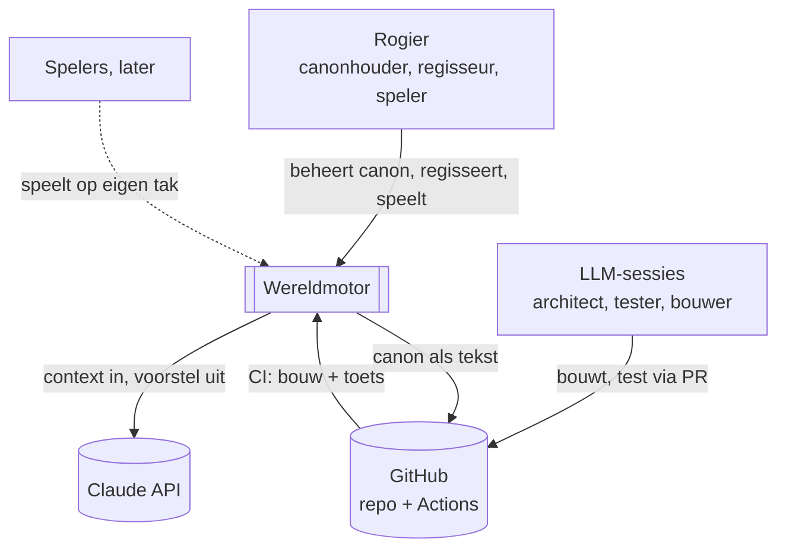
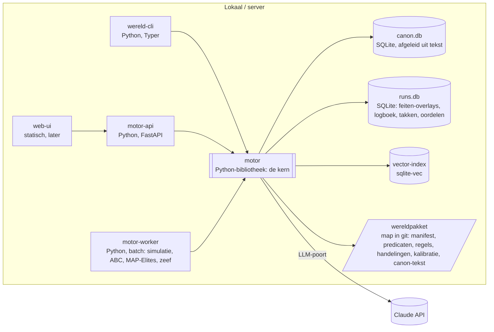
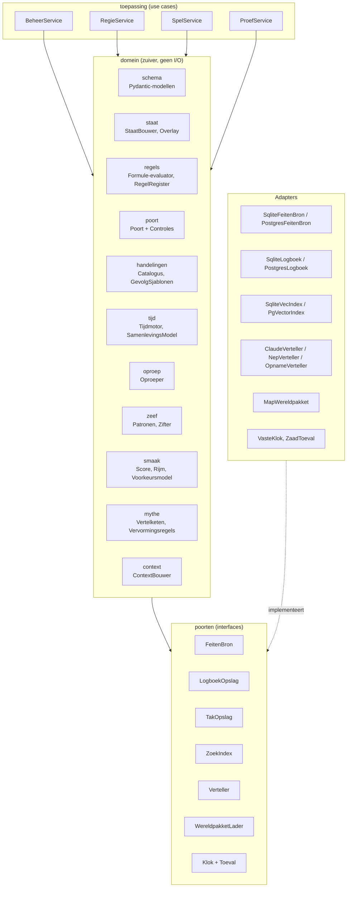
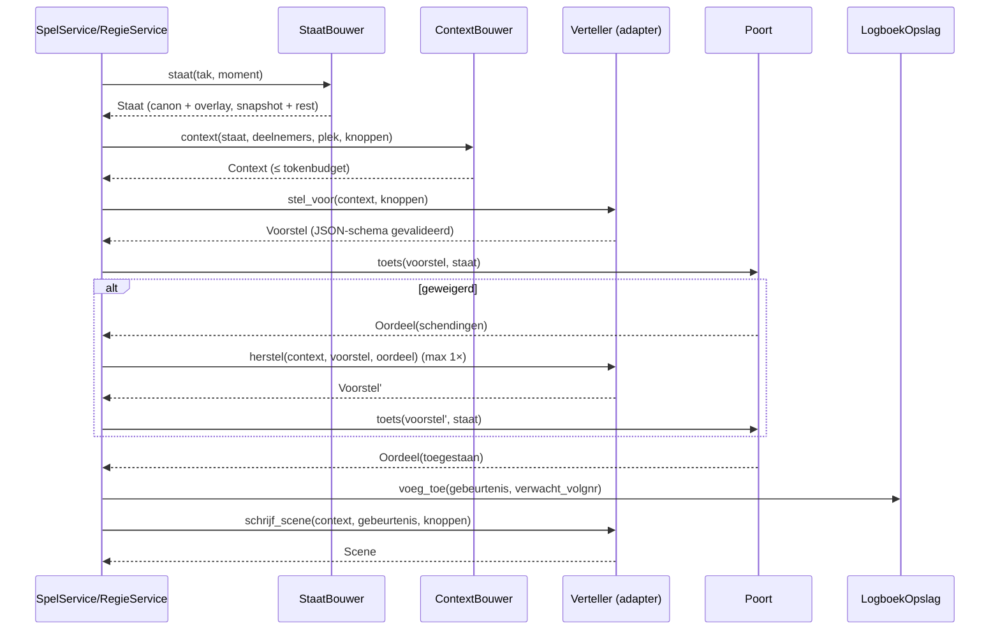

# Wereldmotor: software-architectuur

Versie 0.1, 1 november 2026. Opzet volgens **arc42**, met diagrammen volgens het **C4-model** (context, containers, componenten, code).
Eisen en principes staan in `VISIE_EN_EISEN.md`. Dit document beschrijft **hoe** het systeem gebouwd wordt.
Status: ter bespreking. Na akkoord volgt proef A (speelgoedwereld), zie §12.

---

## 1. Doelen en randvoorwaarden

**Kwaliteitsdoelen (top 5, in volgorde):**
1. **Consistentie.** Geen enkele staatswijziging buiten de poort om. De poort vangt ≥ 95% van de fouten, harde lijnen 100%.
2. **Herhaalbaarheid.** Dezelfde invoer en seed geven dezelfde uitkomst, en afspelen geeft dezelfde hash.
3. **Uitbreidbaarheid.** Een nieuwe wereld, een nieuwe regel, een nieuwe handeling of een nieuw LLM vraagt geen wijziging in de motorcode.
4. **Toetsbaarheid.** Elk onderdeel is los te testen achter interfaces. Nepversies bestaan voor alle externe diensten.
5. **Herleidbaarheid.** Elk feit, oordeel en elke scène wijst naar zijn bron.

**Randvoorwaarden:**

| Soort | Randvoorwaarde |
|---|---|
| Techniek | Python 3.12+. SQLite als eerste opslag. Claude API als eerste LLM. GitHub met Actions. |
| Organisatie | Eén canonhouder (Rogier). Ontwikkeling door LLM-sessies in Claude Code: architect, tester, bouwer. |
| Juridisch en inhoud | Privérepo. Alleen 18+. Harde lijnen in de code, niet alleen in prompts. |
| Bestaand | De canon van Velmara staat als tekst in git, met database, toets en roundtrip (repo `wereld/`). Die blijft werken tot de migratie in iteratie 3. |

---

## 2. Context (C4 niveau 1)



| Buur | Interface | Richting |
|---|---|---|
| GitHub | git (canon als tekst, code), Actions (CI) | beide |
| Claude API | HTTPS, Messages API met gestructureerde uitvoer (tool use met JSON-schema), prompt caching | uit |
| Browser | HTTP/JSON naar de motor-API (vanaf iteratie 4) | in |

---

## 3. Containers (C4 niveau 2)



| Container | Technologie | Verantwoordelijkheid | Staat |
|---|---|---|---|
| **motor** (bibliotheek) | Python-pakket | alle domeinlogica; geen I/O behalve via poorten | stateloos |
| **wereld-cli** | Typer | beheer: pakket laden, toetsen, rondes, kaart, proeven, regie vanaf de commandoregel | stateloos |
| **motor-api** | FastAPI + Uvicorn | regie en spel voor de web-ui; één verzoek = één beurt | stateloos |
| **motor-worker** | Python-proces | lange taken: simulatie, ABC, trekken, zeven; via een takenwachtrij in runs.db | stateloos |
| **canon.db** | SQLite | canon als database, gebouwd uit tekst; alleen-lezen voor de motor | afgeleid |
| **runs.db** | SQLite (later Postgres) | takken, logboek, overlays van feiten, oordelen, scènes, takenwachtrij | bron voor spel en regie |
| **vector-index** | sqlite-vec (later pgvector) | embeddings van canonrijen en feiten, voor ophalen op betekenis | afgeleid |
| **wereldpakket** | bestanden in git (YAML + canon-tekst) | alles wat wereld-specifiek is | bron |

**Waarom canon.db en runs.db gescheiden zijn:** de canon is alleen-lezen voor spel en regie (P1, P9). Een speler kan de canon dus nooit beschadigen. Samenvoegen naar de canon loopt via een export naar een rondescript en een besluit, niet via een schrijfactie op canon.db.

---

## 4. Componenten van de motor (C4 niveau 3)

Hexagonale architectuur (ports and adapters): de **domeinkern** kent alleen interfaces. **Adapters** zitten aan de rand.



### 4.1 Verantwoordelijkheden

| Component | Verantwoordelijk voor | Hangt af van |
|---|---|---|
| `schema` | alle datavormen (P12); JSON-schema-export voor de LLM | niets |
| `staat` | de staat van een tak op een moment bouwen: canonfeiten + overlay uit het logboek; snapshots | FeitenBron, LogboekOpslag |
| `regels` | formules parsen en evalueren (mini-Datalog met negatie als falen, virtuele predicaten); regelregister | schema |
| `poort` | een voorstel toetsen: formuleregels + ingebouwde controles → Oordeel | regels, staat, handelingen |
| `handelingen` | catalogus; voorwaarden en gevolgsjablonen invullen tot wijzigingen | schema |
| `tijd` | tijd laten lopen; het samenlevingsmodel per fase/regio; ABC-bemonstering met ijkpunten | regels, oproep, Toeval |
| `oproep` | deterministische personen uit (plek, jaar, nr) en het samenlevingsmodel | tijd, Toeval |
| `zeef` | verhaalpatronen (formules met tijdsvensters) zoeken in logboeken | regels, LogboekOpslag |
| `smaak` | scores: genre, verwondering, raarheid, verlies, rijm; voorkeursmodel (Bradley-Terry) | zeef, ZoekIndex |
| `mythe` | gebeurtenis → vertellingen per eeuw met vervormingsregels | schema, Verteller |
| `context` | de context voor de verteller samenstellen: feiten, regels, canonrijen, knoppen, tokenbudget | staat, ZoekIndex |
| `BeheerService` | wereldpakket laden en valideren, regels uit proza laten voorstellen, export naar canonronde | alles |
| `RegieService` | scenario draaien: oproepen → verteller → poort → logboek → zeef → smaak | domein |
| `SpelService` | één beurt van een speler afhandelen op zijn tak | domein |
| `ProefService` | proeven A, B en C draaien en rapporteren (§12) | domein |

### 4.2 Interfaces (poorten), als Python-Protocols

```python
class FeitenBron(Protocol):
    def vind(self, onderwerp: str|None, predicaat: str|None, object: Waarde|Ellipsis, jaar: int|None) -> Iterator[Feit]: ...
    def soort(self, entiteit: str) -> str|None: ...
    def versie(self) -> str: ...                      # hash van de canon + pakketversie

class LogboekOpslag(Protocol):
    def voeg_toe(self, g: Gebeurtenis, verwacht_volgnr: int) -> None: ...   # optimistische vergrendeling per tak
    def lees(self, tak: str, tot_volgnr: int|None = None) -> Iterator[Gebeurtenis]: ...
    def laatste(self, tak: str) -> tuple[int, str]: ...                     # (volgnr, hash)

class TakOpslag(Protocol):
    def maak(self, naam: str, ouder: str|None, vanaf: int) -> Tak: ...
    def haal(self, naam: str) -> Tak: ...
    def afstamming(self, naam: str) -> list[Tak]: ...

class ZoekIndex(Protocol):
    def zoek(self, tekst: str, k: int, filter: dict|None = None) -> list[tuple[str, float]]: ...
    def bouw(self, items: Iterable[tuple[str, str]]) -> None: ...

class Verteller(Protocol):
    def stel_voor(self, context: Context, knoppen: Knoppen) -> Voorstel: ...
    def herstel(self, context: Context, voorstel: Voorstel, oordeel: Oordeel) -> Voorstel: ...
    def schrijf_scene(self, context: Context, gebeurtenis: Gebeurtenis, knoppen: Knoppen) -> Scene: ...

class WereldpakketLader(Protocol):
    def laad(self, pad: Path) -> Wereldpakket: ...    # manifest, predicaten, regels, handelingen, kalibratie
    def canonbron(self) -> FeitenBron: ...

class Klok(Protocol):  def nu(self) -> datetime: ...
class Toeval(Protocol): def stroom(self, *sleutel: str|int) -> random.Random: ...   # crc/sha-afgeleide seeds per sleutel
```

### 4.3 Kern-services (toepassingslaag)

```python
class Poort:
    def toets(self, voorstel: Voorstel, staat: Staat) -> Oordeel: ...

class RegieService:
    def draai(self, scenario: Scenario, tak: str, knoppen: Knoppen, n_beurten: int) -> Regierapport: ...

class SpelService:
    def start(self, persoon: str|OproepVraag, moment: Moment, knoppen: Knoppen) -> Tak: ...
    def beurt(self, tak: str, keuze: Spelerkeuze) -> Beurtresultaat: ...      # scène + nieuwe staat of weigering

class BeheerService:
    def laad_pakket(self, pad: Path) -> Pakketrapport: ...
    def stel_regels_voor(self, canoncodes: list[str]) -> list[Regelvoorstel]: ...
    def exporteer_tak(self, tak: str) -> Rondevoorstel: ...                   # naar keuzelijst, nooit direct in de canon
```

---

## 5. Code-niveau: pakketstructuur (C4 niveau 4)

```
motor/                          # de bibliotheek, wereld-onafhankelijk
  schema/        feit.py regel.py handeling.py voorstel.py gebeurtenis.py tak.py knoppen.py scene.py export_jsonschema.py
  domein/
    staat/       bouwer.py overlay.py snapshot.py
    regels/      formule.py evaluator.py virtueel.py register.py
    poort/       poort.py controles/{referentie,predicaat,handeling,kern,kennis,plaats,hoofdlijn,hardelijn}.py
    handelingen/ catalogus.py gevolgen.py
    tijd/        tijdmotor.py samenleving.py abc.py
    oproep/      oproeper.py namen.py
    zeef/        patroon.py zifter.py
    smaak/       score.py rijm.py voorkeur.py
    mythe/       keten.py vervorming.py
    context/     bouwer.py budget.py
  toepassing/    beheer.py regie.py spel.py proef.py
  poorten/       __init__.py (alle Protocols)
  adapters/
    opslag/      sqlite_feiten.py sqlite_logboek.py sqlite_tak.py (later postgres_*.py)
    zoeken/      sqlitevec.py
    verteller/   claude.py nep.py opname.py
    pakket/      map_lader.py
    toeval/      zaad.py
  ingang/        cli.py api.py worker.py
wereldpakketten/
  speelgoed_a/   pakket.yaml predicaten.yaml regels.yaml handelingen.yaml kalibratie.yaml canon/   # proef A
  speelgoed_b/   ...                                                                            # proef B
  velmara/       pakket.yaml ... canon/ → verwijst naar wereld/canon_tekst/                    # iteratie 3
tests/
  eenheid/ contract/ eigenschap/ gouden/ vijandig/ e2e/
architectuur/    VISIE_EN_EISEN.md SOFTWARE_ARCHITECTUUR.md adr/
```

**Afhankelijkheidsregel (gecontroleerd in CI met import-linter):** `schema` ← `domein` ← `toepassing` ← `ingang`. `domein` importeert nooit `adapters`. `adapters` implementeren `poorten`. Zo blijft de kern toetsbaar en vervangbaar.

---

## 6. Gegevensopslag

### 6.1 Wereldpakket (bestanden, in git)

```yaml
# pakket.yaml
naam: velmara
versie: 1.0.0                 # semver: hoofdversie omhoog bij een brekende wijziging in predicaten of regels
motor_versie: ">=0.3,<1.0"
tijd: { eenheid: jaar, nulpunt: "het Zegel", seizoenen: [lente, zomer, herfst, winter] }
fasen: [{nr: 0, naam: Voortijd, van: -1260, tot: -600}, ...]
canon: { soort: canon_tekst, pad: ../../wereld/canon_tekst }
```

```yaml
# regels.yaml (één regel, drie delen)
- code: R-H1
  zin: "Wie aan een seksuele handeling deelneemt, is aantoonbaar 18 jaar of ouder."
  soort: verbod
  harde_lijn: true
  canon_code: BESLUIT-Z30-4
  formule: {alle: [{feit: [VOORSTEL, seksueel, true]}, {feit: [?p, neemt_deel, VOORSTEL]},
                   {niet: {alle: [{feit: [?p, leeftijd, ?n]}, {cmp: [">=", ?n, 18]}]}}]}
```

### 6.2 runs.db (SQLite, DDL)

```sql
create table tak(naam text primary key, ouder text references tak(naam), vanaf_volgnr int not null default 0,
                 pakket text not null, canon_versie text not null, gemaakt text not null, soort text check(soort in ('spel','regie','proef','schrijver')));
create table gebeurtenis(tak text not null references tak(naam), volgnr int not null, moment_jaar int not null,
                 voorstel json not null, vorige_hash text not null, hash text not null, gemaakt text not null,
                 primary key(tak, volgnr));
create table feit_overlay(tak text not null, volgnr int not null, actie text check(actie in ('stel','beeindig')),
                 onderwerp text, predicaat text, object json, van int, tot int, epistemiek text, bron json);
create index ix_overlay_sp on feit_overlay(tak, onderwerp, predicaat);
create table oordeel(id integer primary key, tak text, voorstel json, toegestaan int, schendingen json, verteller text, kosten_cent real, gemaakt text);
create table scene(tak text, volgnr int, tekst text, knoppen json, model text, tokens_in int, tokens_uit int, primary key(tak, volgnr));
create table snapshot(tak text, volgnr int, staat_hash text, blob blob, primary key(tak, volgnr));   -- elke 500 gebeurtenissen
create table taak(id integer primary key, soort text, invoer json, status text, uitvoer json, gemaakt text, klaar text);
create table voorkeur(id integer primary key, winnaar text, verliezer text, context json, gemaakt text);  -- Bradley-Terry
```

**Hash-keten:** `hash = sha256(tak, volgnr, voorstel-json (gesorteerd), vorige_hash)`. Een gebroken keten maakt de tak ongeldig, en de CI-proef controleert dat.

**Gelijktijdigheid:** één schrijver per tak. `voeg_toe` faalt als `verwacht_volgnr` niet het volgende is (optimistische vergrendeling). Verschillende takken zijn onafhankelijk.

---

## 7. Runtime-scenario's

### 7.1 Eén beurt (regie of spel)



### 7.2 Wereldpakket laden
`MapWereldpakket.laad` → manifest valideren (semver, motorversie) → predicaten registreren → regels parsen en **zelftest** draaien (elke regel heeft een voorbeeld dat moet slagen en een voorbeeld dat moet falen) → handelingen controleren tegen predicaten → canonbron opbouwen → `versie()` = hash(canon + pakket).

### 7.3 Tak samenvoegen
`BeheerService.exporteer_tak` → gebeurtenissen van de tak opnieuw door de poort tegen de **huidige** canon → indeling in past, wringt en botst → een rondevoorstel (YAML) voor de keuzelijst. Canon verandert pas via een rondescript na het besluit.

### 7.4 Simulatie met ijkpunten (worker)
`tijd.abc.draai(fase, ijkpunten, n)` → per loop een eigen zaadstroom → simulatie per seizoen → afstand tot de ijkpunten → accepteren onder een drempel (ABC). Bij meerdere fasen: populatie overdragen (ABC-SMC) → resultaten als `simulatie`-feiten op een proeftak.

---

## 8. Uitrol (deployment)

| Fase | Opzet |
|---|---|
| Nu tot iteratie 3 | Alles lokaal of in een Claude Code-sessie: `pip install -e .`, CLI, SQLite-bestanden. CI in GitHub Actions. |
| Iteratie 4 en 5 | Eén server of VM met Docker Compose: `motor-api`, `motor-worker`, een volume voor `runs.db`, en statische `web-ui`. Geheimen (API-sleutel) via omgevingsvariabelen. |
| Groei | Postgres en pgvector in plaats van SQLite (adapters wisselen), meerdere workers, wachtrij naar Redis of Postgres. Geen wijziging in `domein`. |

---

## 9. Doorsnijdende concepten

| Concept | Oplossing |
|---|---|
| **Determinisme** | Klok en Toeval zijn poorten. Elke stroom willekeur heeft een sleutel (tak, beurt, doel). LLM-uitvoer wordt opgeslagen, zodat afspelen niet opnieuw het model aanroept. |
| **Versiebeheer** | Motor en wereldpakket hebben elk semver. Elke tak legt pakket- en canonversie vast. Migraties van runs.db zijn genummerd (zoals nu in `wereld/migraties`). |
| **Foutmodel** | Domeinfouten (een weigering) zijn **geen** exceptions maar Oordelen. Exceptions alleen voor technische fouten. Een LLM-uitvoer die niet bij het schema past, telt als een weigering in de categorie "schema". |
| **Waarneembaarheid** | Elk voorstel krijgt een id. Gestructureerde logregels (JSON) met tak, volgnr, regelcodes, tokens, kosten en duur. Een rapport per proef. |
| **Prestaties** | Indexen op (onderwerp, predicaat) en (predicaat, object). Een overlay in plaats van kopiëren. Snapshots per 500 gebeurtenissen. Prompt caching van de vaste context. Budget per beurt: poort < 50 ms, context < 200 ms. |
| **Beveiliging en inhoud** | Harde lijnen als systeemregels in de motor (niet uitschakelbaar per pakket). Leeftijdscontrole (18+) in de API. Privérepo. Sleutels nooit in git. |
| **Internationalisering** | Schema- en codenamen neutraal en stabiel. Zinnen van regels en uitleg in de taal van het pakket (Velmara: Nederlands). |
| **Kosten** | Teller per aanroep (tokens en centen) in `oordeel` en `scene`. Een budget per tak, met stop bij overschrijding. |

---

## 10. Architectuurbeslissingen (ADR, kort)

| ADR | Beslissing | Alternatieven | Gevolg |
|---|---|---|---|
| 001 | Hexagonaal: domein zonder I/O, poorten en adapters | gelaagde monoliet | toetsbaar en vervangbaar; iets meer opzetwerk |
| 002 | Universele tijdgebonden feiten (triples met van, tot, bron, zekerheid) | tabellen per onderwerp | één regeltaal over alles; minder snel voor grote aggregaten (die blijven in het samenlevingsmodel) |
| 003 | Event sourcing per tak met hash-keten | alleen laatste staat bewaren | afspelen, takken en oogst; opslag groeit (snapshots) |
| 004 | Eigen mini-Datalog als regeltaal, regels als gegevens (YAML) | Prolog, clingo, Soufflé, Python-code | leesbaar en klein; later vervangbaar door Soufflé zonder regels te herschrijven |
| 005 | LLM alleen via het Verteller-protocol met JSON-schema-uitvoer | vrije tekst ontleden | voorspelbaar en te toetsen |
| 006 | canon.db (alleen-lezen) en runs.db gescheiden | één database | spel kan de canon niet beschadigen |
| 007 | Wereldpakket als map met manifest (YAML) en semver | configuratie in code | wereld-onafhankelijk (N9) |
| 008 | SQLite en sqlite-vec eerst, Postgres en pgvector later | meteen Postgres | eenvoud nu, wisselen via adapters |
| 009 | FastAPI voor de API, Typer voor de CLI, Pydantic v2 voor de schema's | Flask, Click, dataclasses | schema-export naar JSON voor de LLM; gangbaar en goed gedocumenteerd |
| 010 | Geen game-engine tot er beeld komt | Godot of Unity nu | focus op de motor; de UI is een dunne laag |

---

## 11. Kwaliteitsscenario's en testarchitectuur

| Laag | Wat | Gereedschap | Wie schrijft |
|---|---|---|---|
| Eenheid | evaluator, controles, gevolgsjablonen, hash | pytest | tester (vóór de bouw) |
| Contract | elke adapter voldoet aan zijn Protocol (zelfde tests voor SQLite en later Postgres) | pytest, gedeelde testsuite | tester |
| Eigenschap | "afspelen = zelfde hash", "oproepen herhaalbaar", "geen gebeurtenis zonder toegestaan oordeel" | Hypothesis | tester |
| Gouden | vaste invoer → vaste uitvoer (oordelen, kaart) | snapshot-bestanden | tester |
| Vijandig | duizenden expres foute voorstellen per categorie; meet vangpercentage en onterechte weigeringen | eigen generator | tester |
| E2E | pakket laden → regie 50 beurten met de nepverteller → zeef → rapport | pytest + CLI | tester |
| Architectuur | afhankelijkheidsregels van §5 | import-linter in CI | architect |

**CI (GitHub Actions):** lint (ruff) → type-check (mypy, strikt in `schema` en `domein`) → import-linter → tests → proef A met rapport als artefact → canon-toets (bestaande `wereld/velmara.py bouw`).

---

## 12. Proeven: hoe de architectuur bewezen wordt

| Proef | Bewijst | Opzet | Geslaagd als |
|---|---|---|---|
| **A: speelgoedwereld** | de hele keten werkt: schema's, staat, regels, poort, logboek, takken, oproepen, zeef, nepverteller, CLI | pakket `speelgoed_a`: 2 dorpen, 10 personen, 10 regels, 10 handelingen, 50 jaar | alle tests groen; vijandige set: ≥ 95% gevangen, harde lijnen 100%, ≤ 5% onterecht geweigerd; afspelen geeft dezelfde hash |
| **B: tweede wereld** | wereld-onafhankelijkheid | pakket `speelgoed_b` met andere predicaten, regels en tijdrekening | proef A-tests slagen op B zonder één wijziging in `motor/` |
| **C: echte verteller** | het LLM-contract | `ClaudeVerteller` op wereld A | ≥ 90% van de voorstellen past bij het schema; na één herstel ≥ 95% toegestaan of terecht geweigerd; kosten per beurt gemeten |
| **D: Velmara-schijf** (na A–C) | schaal en echte canon | pakket `velmara` (801), hele canon als feiten | N1–N8 gehaald op de echte canon |

Pas als A, B en C groen zijn, wordt het systeem groot opgezet (iteratie 3).

---

## 13. Risico's en technische schuld

| Risico | Maatregel |
|---|---|
| De mini-Datalog wordt te traag bij veel regels | indexen en een overlay; meten in proef D; Soufflé als vervanger (ADR 004) |
| De feiten-triples zijn te traag voor aggregaten (bevolking) | aggregaten blijven in het samenlevingsmodel (`tijd`), niet als miljoenen feiten |
| Het JSON-schema is te groot voor de LLM | een apart, smal Voorstel-schema; het volledige schema alleen intern |
| De bestaande `wereld/`-code en de nieuwe motor lopen uiteen | in iteratie 3 wordt `wereld/` het wereldpakket `velmara`; de toets en de roundtrip blijven als pakketcontrole |
| De rollen architect, tester en bouwer lekken in elkaar | aparte sessies; de tester ziet geen bouwcode vóór zijn tests staan; reviews via PR |
